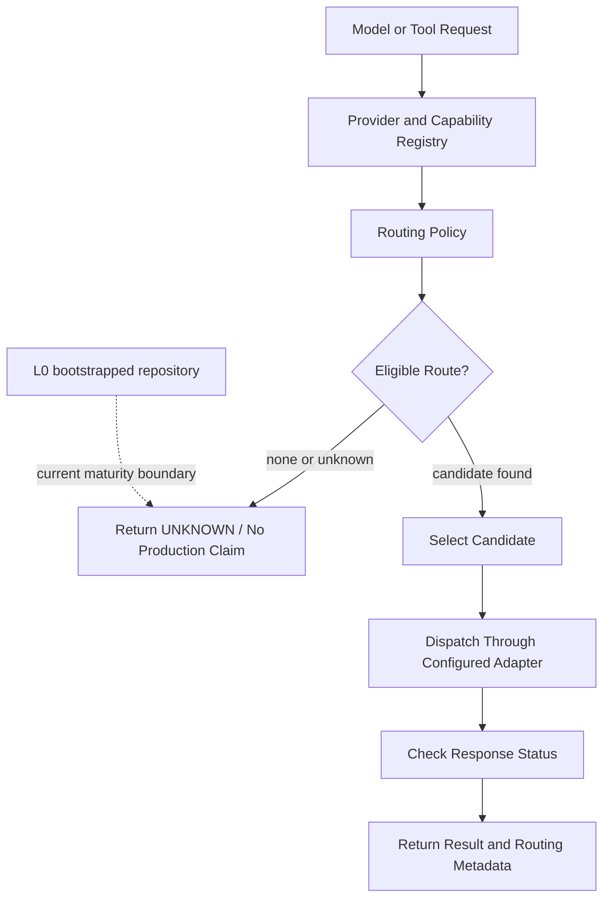

# x4-router

X4 independent parent — **routing** (policies, registry). gRPC. Fleet id **2**.

| Field | Value |
|-------|-------|
| Completion | **L0** — bootstrapped |
| Boundary | independent-parent |

No production routing is claimed until evidence states advance.

<!-- X4-APEX-DIAGRAM-START:x4-router -->

<!-- X4-APEX-DIAGRAM-END:x4-router -->

