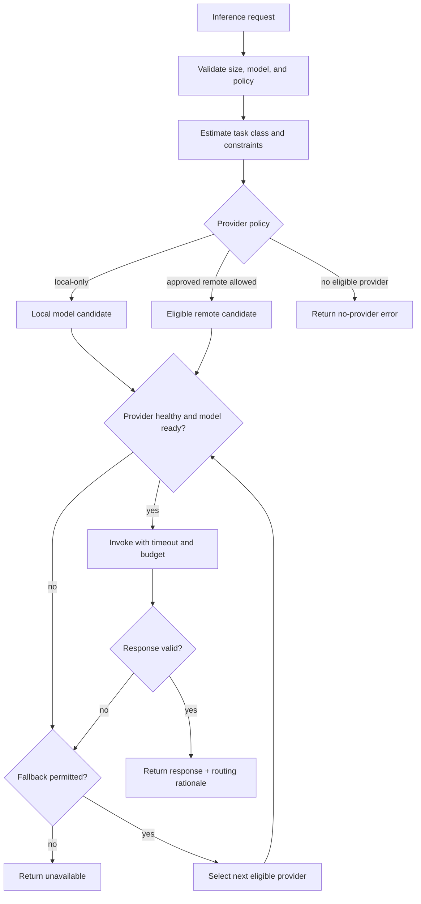

# x4-router

X4 independent parent — **routing** (policies, registry). gRPC. Fleet id **2**.

| Field | Value |
|-------|-------|
| Completion | **L0** — bootstrapped |
| Boundary | independent-parent |

No production routing is claimed until evidence states advance.

## APEX Architecture Map

> Status: architecture documentation; implementation and deployment claims require independent verification.

**Evidence note:** Routing policy, health probes, fallback ordering, and budget enforcement must be validated in code; do not imply remote routing is active unless explicitly configured.

